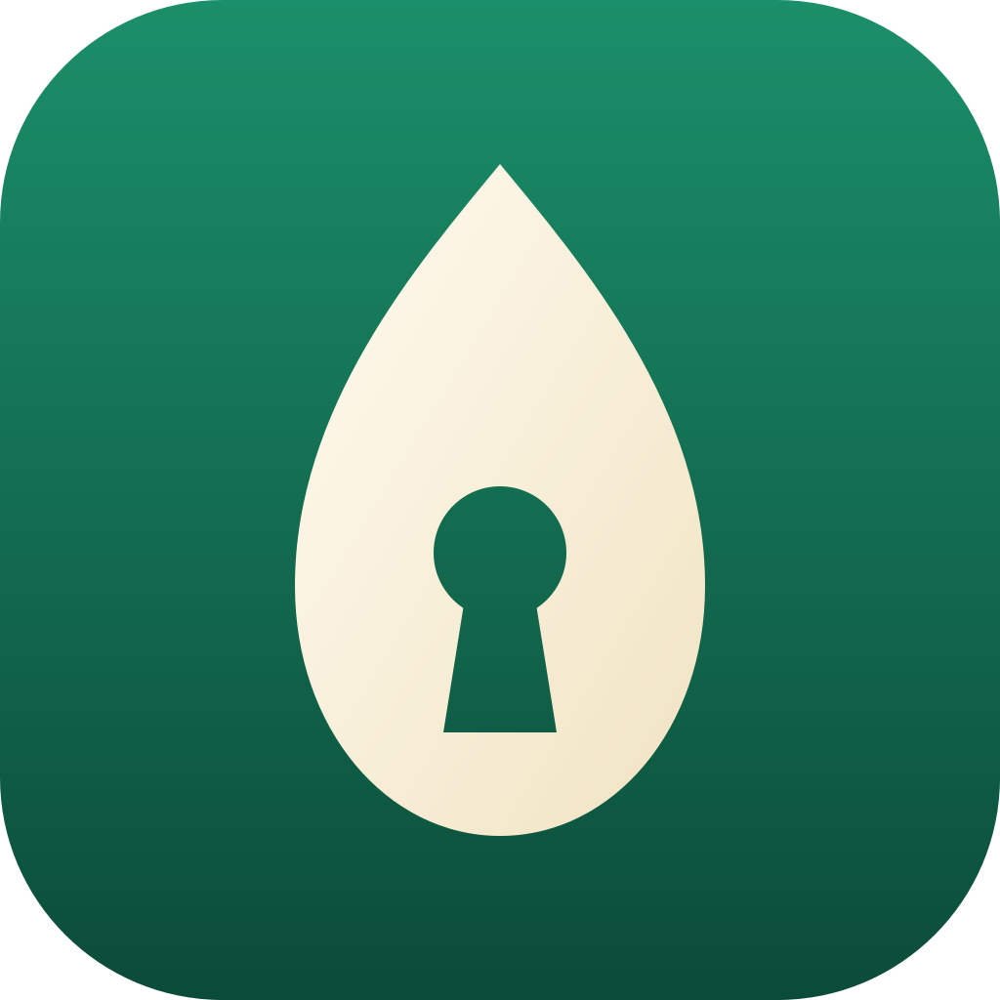
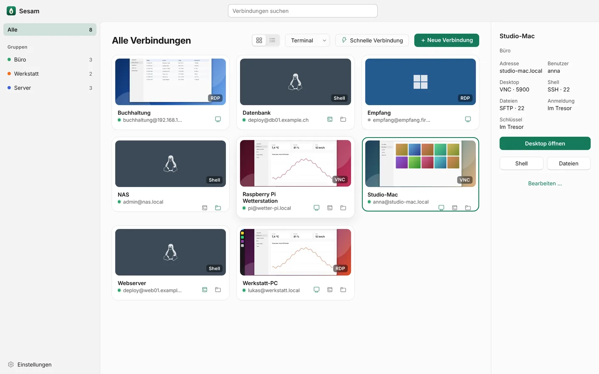

<p align="center">
  
</p>

<h1 align="center">Sesam Remote</h1>

<p align="center">
  <b>Bildschirm, Shell und Dateien deiner Rechner, in einer App.</b><br>
  Open Source für macOS, Windows, Linux und iPad: RDP, VNC, SSH, SFTP und FTP.
</p>

<p align="center">
  <a href="https://sesam-remote.app">Website</a> ·
  <a href="https://github.com/MiDo1412/sesam-remote/releases/latest">Download</a> ·
  <a href="https://sesam-remote.app/support.html">Support</a> ·
  <a href="https://sesam-remote.app/datenschutz.html">Datenschutz</a> ·
  <a href="docs/release-notes.md">Neuigkeiten</a>
</p>

<p align="center">
  <a href="https://github.com/MiDo1412/sesam-remote/releases/latest"></a>
  <a href="LICENSE"></a>
  
</p>

<picture>
  <source media="(prefers-color-scheme: dark)" srcset="website/img/lib-dark-1440.webp">
  
</picture>

## Was Sesam kann

Jeder Rechner ist ein Eintrag in einer Bibliothek, mit drei Türen: **Desktop**, **Shell** und **Dateien**.
Beim Anlegen klopft Sesam an die üblichen Ports und schaltet ein, was antwortet.

- **Remotedesktop per RDP** (IronRDP): Windows, GNOME Remote Desktop unter Wayland samt Anmeldebildschirm,
  xrdp. Mit RD-Gateway, Kerberos, H.264, Ton, Zwischenablage, Ordnerfreigabe und mehreren Monitoren.
- **Remotedesktop per VNC**, nativ in Rust: Mac-Bildschirmfreigabe (Apple-Anmeldung), Raspberry Pi
  (wayvnc, RealVNC), VeNCrypt mit TLS und Zertifikat-Pinning. Die Auflösung folgt dem Fenster.
- **SSH-Shell** (russh, xterm.js) mit Passwort, Schlüssel oder Agent, Sprungserver, Portweiterleitungen und
  tmux-Sitzungen, die Netzwechsel und Abbrüche überstehen.
- **Dateien** zweispaltig über SFTP, SCP oder FTP/FTPS: Ziehen und Ablegen, Ordner vergleichen, Rechte ändern,
  Papierkorb und «Rückgängig», Fortsetzen nach einem Abbruch.
- **Gemeinsame Zwischenablage** für Text, Bilder und Dateien, mit Verlauf.
- **Wake-on-LAN**, Online-Status, automatisches Neuverbinden und «Erste Hilfe», die Schritt für Schritt
  zeigt, woran eine Verbindung scheitert.
- **Tastenkürzel** wie ⌘Tab bzw. Alt+Tab gehen an den entfernten Rechner, solange sein Bild aktiv ist.

Was auf welchem System geht und warum: [docs/plattformen.md](docs/plattformen.md).

## Sicherheit und Datenschutz

- Kein Konto, kein Cloud-Dienst, keine Telemetrie. Sesam verbindet sich direkt mit deinen Rechnern.
- Passwörter und SSH-Schlüssel liegen nur im Schlüsselbund des Systems (macOS- und iPadOS-Schlüsselbund,
  Windows-Anmeldeinformationsverwaltung, Secret Service unter Linux). Die Bibliothek enthält keine Geheimnisse.
- Hostschlüssel und Zertifikate werden beim ersten Verbinden bestätigt; ändern sie sich, warnt Sesam.
- Sicherungen sind mit eigenem Passwort verschlüsselt (AES-256-GCM, Argon2id).
- Datenschutzerklärung: [sesam-remote.app/datenschutz.html](https://sesam-remote.app/datenschutz.html) ·
  Sicherheitsprüfung: [docs/security-review-2026-11-11.md](docs/security-review-2026-11-11.md)

Sicherheitslücke gefunden? Bitte vertraulich an [support@sesam-remote.app](mailto:support@sesam-remote.app)
mit dem Betreff «Sicherheit», nicht als öffentliches Issue.

## Download

| System | Datei | Hinweis |
|---|---|---|
| **macOS** (Apple-Chip) | [Sesam-Remote_macOS.dmg](https://github.com/MiDo1412/sesam-remote/releases/latest/download/Sesam-Remote_macOS.dmg) · [portabel (ZIP)](https://github.com/MiDo1412/sesam-remote/releases/latest/download/Sesam-Remote_macOS_portabel.zip) | Noch nicht notarisiert: beim ersten Start Rechtsklick › Öffnen. Nicht im Mac App Store, weil dessen Sandbox lokales Terminal und Tastenkürzel verbietet. |
| **Windows** 10 und 11 | [Sesam-Remote_Windows.msi](https://github.com/MiDo1412/sesam-remote/releases/latest/download/Sesam-Remote_Windows.msi) · [portabel (ZIP)](https://github.com/MiDo1412/sesam-remote/releases/latest/download/Sesam-Remote_Windows_portabel.zip) | Noch ohne Signatur: SmartScreen › Weitere Informationen › Trotzdem ausführen. MSI still installierbar, auch über Intune ([docs/intune.md](docs/intune.md)). |
| **Linux** x86-64 | [Sesam-Remote_Linux.AppImage](https://github.com/MiDo1412/sesam-remote/releases/latest/download/Sesam-Remote_Linux.AppImage) · [.deb](https://github.com/MiDo1412/sesam-remote/releases/latest/download/Sesam-Remote_Linux.deb) · [portabel (ZIP)](https://github.com/MiDo1412/sesam-remote/releases/latest/download/Sesam-Remote_Linux_x64_portabel.zip) | Mit WebKitGTK, etwa Ubuntu ab 24.04. |
| **iPad** | bald im App Store | Ab iPadOS 16 ([docs/app-store.md](docs/app-store.md)). |

Alle Dateien und Prüfsummen (`SHA256SUMS`): [neueste Version](https://github.com/MiDo1412/sesam-remote/releases/latest).
Die Mac-App, das AppImage und die portablen Fassungen aktualisieren sich selbst.

**Portabel:** Liegt neben der App eine Datei `portable` oder ein Ordner `Sesam-Daten`, legt Sesam Bibliothek
und Einstellungen dort ab ([docs/portabel.md](docs/portabel.md)).

## Rechner vorbereiten

Anleitungen für die Gegenseite, dieselben wie in der App:

| Ziel | Anleitung |
|---|---|
| Windows (Remotedesktop) | [docs/hilfe/rdp-windows.md](docs/hilfe/rdp-windows.md) |
| Ubuntu mit GNOME (RDP, auch Wayland und Anmeldebildschirm) | [docs/hilfe/rdp-gnome.md](docs/hilfe/rdp-gnome.md) · Setup-Script [src-tauri/resources/sesam-rdp-setup.sh](src-tauri/resources/sesam-rdp-setup.sh) |
| Linux mit xrdp | [docs/hilfe/rdp-xrdp.md](docs/hilfe/rdp-xrdp.md) |
| Mac (Bildschirmfreigabe, Entfernte Anmeldung) | [docs/hilfe/macos.md](docs/hilfe/macos.md) |
| Raspberry Pi und andere (VNC, wayvnc) | [docs/hilfe/vnc.md](docs/hilfe/vnc.md) · [docs/hilfe/wayvnc.md](docs/hilfe/wayvnc.md) |
| SSH und SFTP | [docs/hilfe/ssh.md](docs/hilfe/ssh.md) |
| FTP und FTPS | [docs/hilfe/ftp.md](docs/hilfe/ftp.md) |
| Zugangsdaten und Schlüssel | [docs/hilfe/zugangsdaten.md](docs/hilfe/zugangsdaten.md) |

Hilfe bei Problemen: [sesam-remote.app/support.html](https://sesam-remote.app/support.html) oder
[support@sesam-remote.app](mailto:support@sesam-remote.app).

## Selbst bauen

Voraussetzungen: Rust (stable), Node 20+; unter Windows WebView2 und die MSVC Build Tools
([docs/build-windows.md](docs/build-windows.md)); unter Linux WebKitGTK; für das iPad Xcode.

```bash
git clone https://github.com/MiDo1412/sesam-remote.git
cd sesam-remote
npm install
npm run tauri dev
```

Prüfen:

```bash
npm run build
cd src-tauri && cargo test
```

Bauen, signieren und Updates: [docs/release.md](docs/release.md) · Versionsnummern (JJ.M.N):
[docs/versionierung.md](docs/versionierung.md).

## Dokumentation

| Datei | Inhalt |
|---|---|
| [docs/architektur.md](docs/architektur.md) | Aufbau und Module |
| [docs/plattformen.md](docs/plattformen.md) | Funktionen je System, Vertrieb |
| [docs/release-notes.md](docs/release-notes.md) | Änderungen je Version |
| [docs/design-konzept.md](docs/design-konzept.md) | Gestaltung «Inhalt und Glas», Tokens, Knöpfe, Blätter |
| [docs/design-inventar.md](docs/design-inventar.md) | Prüfstand jedes Bildschirms, hell und dunkel |
| [docs/beschriftungen.md](docs/beschriftungen.md) | Begriffe in der Oberfläche |
| [docs/app-store.md](docs/app-store.md) | Stores und Signieren |
| [docs/release.md](docs/release.md) | Bauen, signieren, automatische Updates |
| [docs/build-windows.md](docs/build-windows.md) | Unter Windows bauen |
| [docs/intune.md](docs/intune.md) | Windows: MSI über Intune verteilen |
| [docs/portabel.md](docs/portabel.md) | Portable Fassungen |
| [docs/security-review-2026-11-11.md](docs/security-review-2026-11-11.md) | Sicherheitsprüfung |
| [docs/offene-punkte.md](docs/offene-punkte.md) | Bewusst Offenes |
| [docs/lizenzen/](docs/lizenzen/) | Lizenzen von Schriften und Symbolen |
| [website/](website/) | Quelle von sesam-remote.app |

## Mitmachen

Fehler und Wünsche als [Issue](https://github.com/MiDo1412/sesam-remote/issues), Änderungen als Pull Request.
Neue Funktionen sollen auf allen Systemen laufen, wo es geht; was wo geht, steht in
[docs/plattformen.md](docs/plattformen.md).

## Lizenz

[Mozilla Public License 2.0](LICENSE). Schriften und Symbole stehen unter ihren eigenen Lizenzen
([docs/lizenzen/](docs/lizenzen/)).

© 2026 Mike Dörig, Schweiz
